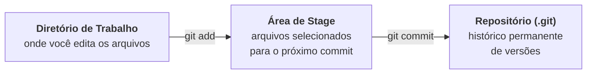

# Módulo 1 — Conceitos Fundamentais

> ⏱️ Duração estimada: 30 minutos
> 📋 Pré-requisitos: nenhum
> 🎬 Slides da aula: [apresentacao-01-conceitos.pdf](apresentacao-01-conceitos.pdf)

## 1.1 O problema: a vida sem controle de versão

Você provavelmente já viveu (ou vai viver) esta cena:

```
📁 TrabalhoFinal/
├── trabalho.js
├── trabalho_v2.js
├── trabalho_v2_corrigido.js
├── trabalho_FINAL.js
├── trabalho_FINAL_AGORA_VAI.js
└── trabalho_FINAL_entregar_ESSE.js
```

Problemas dessa abordagem:

- ❌ Qual é a versão mais recente? Ninguém sabe;
- ❌ O que mudou da `v2` para a `v2_corrigido`? Impossível dizer;
- ❌ Se o HD queimar, perdeu tudo;
- ❌ Dois colegas editando o mesmo arquivo? Alguém vai sobrescrever o trabalho do outro;
- ❌ "Funcionava ontem e hoje não funciona mais" — e não há como voltar atrás.

O **controle de versão** resolve todos esses problemas.

## 1.2 O que é um sistema de controle de versão?

É um software que **registra as alterações feitas em arquivos ao longo do tempo**, permitindo:

- 📸 **Fotografar** o estado do projeto em momentos específicos (cada foto é um *commit*);
- ⏪ **Voltar** para qualquer versão anterior;
- 🔍 **Comparar** versões e ver exatamente o que mudou, quando e quem mudou;
- 👥 **Colaborar** com outras pessoas no mesmo projeto sem sobrescrever o trabalho alheio.

> 💡 **Analogia:** pense nos *save points* de um videogame. Você salva o progresso em pontos importantes e, se algo der errado, volta ao último save. O Git são os save points do seu código — com a diferença de que você pode voltar a **qualquer** save, não só ao último.

## 1.3 O que é o Git?

O **Git** é o sistema de controle de versão mais usado no mundo. Foi criado em 2005 por **Linus Torvalds** (o mesmo criador do Linux) para gerenciar o desenvolvimento do kernel do Linux.

Características importantes:

- 🖥️ **Roda na sua máquina** — você não precisa de internet para usar o Git;
- 🆓 **Gratuito e open source**;
- ⚡ **Rápido** — operações levam frações de segundo mesmo em projetos gigantes;
- 🌎 **Padrão de mercado** — praticamente toda empresa de software usa Git.

### Os três estados de um arquivo no Git

Este é **o conceito mais importante do curso**. No Git, um arquivo passa por três áreas:



1. **Diretório de trabalho** (*working directory*): a pasta do projeto, onde você cria e edita arquivos normalmente;
2. **Área de stage** (*staging area*): uma "área de preparação" onde você coloca os arquivos que farão parte da próxima "foto";
3. **Repositório** (*repository*): o histórico permanente, guardado na pasta oculta `.git`.

> 💡 **Analogia:** imagine que você vai tirar uma foto de grupo.
> - O **diretório de trabalho** é a festa toda, com todo mundo circulando;
> - A **área de stage** é o palco onde você posiciona quem vai sair na foto;
> - O **commit** é o clique da câmera: a foto vai para o **álbum** (repositório) para sempre.

## 1.4 O que é o GitHub?

Aqui está uma confusão clássica de iniciante. Vamos resolvê-la agora:

| | Git | GitHub |
|---|---|---|
| **O que é** | Software de controle de versão | Site/plataforma na internet |
| **Onde roda** | Na sua máquina | Na nuvem |
| **Precisa de internet?** | Não | Sim |
| **Função** | Versionar os arquivos | Hospedar repositórios Git e permitir colaboração |
| **Quem mantém** | Comunidade open source | Microsoft |

> ⚠️ **Git ≠ GitHub.** O Git é a ferramenta; o GitHub é um serviço que hospeda projetos Git na nuvem. Existem alternativas ao GitHub (GitLab, Bitbucket, Codeberg...), mas todas usam o **mesmo Git** por baixo.

> 💡 **Analogia:** o Git está para o GitHub assim como as **fotos** estão para o **Google Fotos**. Você tira fotos com sua câmera (Git, local) e pode enviá-las para a nuvem (GitHub) para ter backup e compartilhar com outras pessoas.

O GitHub adiciona recursos de colaboração por cima do Git:

- 🌐 Backup dos seus repositórios na nuvem;
- 👥 Ferramentas de colaboração (Pull Requests, Issues, revisão de código);
- 📢 Portfólio público — **recrutadores olham o GitHub de candidatos**;
- 🤝 Acesso a milhões de projetos open source.

## 1.5 Vocabulário essencial

Guarde estes termos — eles aparecerão o semestre inteiro:

| Termo | Significado |
|-------|-------------|
| **Repositório (repo)** | A pasta do projeto + todo o seu histórico de versões |
| **Commit** | Uma "foto" do projeto em um momento específico, com autor, data e mensagem |
| **Stage / Staging** | Área de preparação dos arquivos para o próximo commit |
| **Branch** | Uma linha de desenvolvimento independente (veremos no Módulo 5) |
| **Remote (remoto)** | Uma cópia do repositório hospedada em outro lugar (ex.: GitHub) |
| **Clone** | Baixar uma cópia completa de um repositório remoto |
| **Push** | Enviar seus commits locais para o remoto |
| **Pull** | Trazer commits do remoto para sua máquina |

## ✅ Checkpoint do módulo

Antes de avançar, você deve saber responder:

1. Que problemas o controle de versão resolve?
2. Qual a diferença entre Git e GitHub?
3. Quais são os três estados de um arquivo no Git?
4. O que é um commit?

---

⬅️ [Voltar ao início](../README.md) | ➡️ [Módulo 2 — Instalação e Configuração](../02-instalacao-config/README.md)
