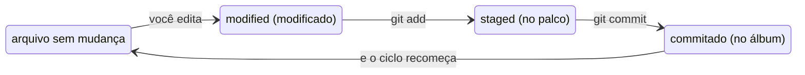

# Módulo 3 — Comandos Básicos do Git

> ⏱️ Duração estimada: 1 hora
> 📋 Pré-requisitos: [Módulo 2](../02-instalacao-config/README.md)
> 🎬 Slides da aula: [apresentacao-03-comandos-basicos.pdf](apresentacao/apresentacao-03-comandos-basicos.pdf)

Neste módulo, tudo acontece **na sua máquina** — nada de GitHub ainda. Vamos criar um repositório do zero e aprender o ciclo fundamental do Git.

## 3.1 Antes de tudo: navegando no terminal

Você usará estes comandos de terminal o tempo todo:

| Comando | O que faz | Exemplo |
|---------|-----------|---------|
| `pwd` | Mostra em qual pasta você está | `pwd` |
| `ls` | Lista os arquivos da pasta atual | `ls` |
| `cd nome` | Entra na pasta `nome` | `cd projetos` |
| `cd ..` | Volta uma pasta | `cd ..` |
| `mkdir nome` | Cria uma pasta | `mkdir meu-projeto` |

## 3.2 `git init` — criando um repositório

Vamos criar um projeto de exemplo:

```bash
# Crie e entre na pasta do projeto
mkdir ola-git
cd ola-git

# Transforme a pasta em um repositório Git
git init
```

Saída:

```
Initialized empty Git repository in /home/aluno/ola-git/.git/
```

O `git init` criou uma pasta oculta chamada **`.git`** — é ali que o Git guarda todo o histórico. Você **nunca** deve mexer nela diretamente.

> ⚠️ O `git init` é feito **uma única vez por projeto**, na pasta **raiz** do projeto. Não rode `git init` dentro de um repositório que já existe, nem em pastas genéricas como `Documentos` ou a sua pasta de usuário.

## 3.3 `git status` — o comando que você mais vai usar

O `git status` mostra a situação atual do repositório. Rode-o **a todo momento** — antes e depois de cada comando, até criar intimidade com o Git:

```bash
git status
```

```
On branch main

No commits yet

nothing to commit (create/copy files and track with "git add")
```

Tradução: "repositório vazio, nenhum commit ainda, nada para commitar".

## 3.4 Criando o primeiro arquivo

Crie um arquivo `index.js` (pode usar o VS Code ou o comando abaixo):

```bash
echo 'console.log("Olá, Git!");' > index.js
```

Agora veja o que o Git diz:

```bash
git status
```

```
On branch main

No commits yet

Untracked files:
  (use "git add <file>..." to include in what will be committed)
        index.js

nothing added to commit but untracked files present (use "git add" to track)
```

O arquivo aparece como **untracked** (não rastreado): o Git o vê na pasta, mas ainda não o acompanha. Repare que o próprio Git sugere o próximo passo: `git add`.

## 3.5 `git add` — enviando para a área de stage

```bash
git add index.js
git status
```

```
On branch main

No commits yet

Changes to be committed:
  (use "git rm --cached <file>..." to unstage)
        new file:   index.js
```

O arquivo agora está **staged** — posicionado no "palco", pronto para a foto.

Variações úteis do `git add`:

```bash
git add index.js           # adiciona um arquivo específico
git add src/               # adiciona uma pasta inteira
git add .                  # adiciona TUDO que mudou na pasta atual
```

> ⚠️ O `git add .` é prático, mas perigoso: ele adiciona **tudo**, inclusive arquivos que não deveriam ir (veremos o `.gitignore` no Módulo 7). Crie o hábito de rodar `git status` antes, para saber o que está entrando.

## 3.6 `git commit` — tirando a foto

```bash
git commit -m "Adiciona programa inicial que imprime saudação"
```

```
[main (root-commit) a1b2c3d] Adiciona programa inicial que imprime saudação
 1 file changed, 1 insertion(+)
 create mode 100644 index.js
```

🎉 **Você fez seu primeiro commit!** A "foto" do projeto foi gravada permanentemente no histórico, com:

- Um **identificador único** (`a1b2c3d...` — o *hash*);
- Seu **nome e e-mail** (do `git config`);
- **Data e hora**;
- A **mensagem** que descreve a mudança.

> 💡 A opção `-m` significa *message*. Sem ela, o Git abre o editor de texto para você escrever a mensagem — por enquanto, use sempre `-m`.

## 3.7 O ciclo completo: modificar → add → commit

Este é o ciclo que você repetirá centenas de vezes no semestre. Vamos praticá-lo. Edite o `index.js`:

```javascript
console.log("Olá, Git!");
console.log("Este é meu segundo commit.");
```

```bash
git status
```

```
Changes not staged for commit:
  (use "git add <file>..." to update what will be committed)
        modified:   index.js
```

Agora o arquivo aparece como **modified**: o Git sabe que ele mudou desde o último commit. Complete o ciclo:

```bash
git add index.js
git commit -m "Adiciona segunda mensagem no programa"
```



## 3.8 `git log` — vendo o histórico

```bash
git log
```

```
commit f4e5d6c7... (HEAD -> main)
Author: Maria Silva <maria@exemplo.com>
Date:   Tue Jul 7 10:32:00 2026 -0300

    Adiciona segunda mensagem no programa

commit a1b2c3d4...
Author: Maria Silva <maria@exemplo.com>
Date:   Tue Jul 7 10:15:00 2026 -0300

    Adiciona programa inicial que imprime saudação
```

Versão compacta (ótima para o dia a dia):

```bash
git log --oneline
```

```
f4e5d6c (HEAD -> main) Adiciona segunda mensagem no programa
a1b2c3d Adiciona programa inicial que imprime saudação
```

> 💡 `HEAD` é um ponteiro que indica "onde você está agora" no histórico. Por enquanto, ele sempre apontará para o commit mais recente do branch `main`.

## 3.9 `git diff` — o que mudou?

Edite o `index.js` de novo (mude qualquer linha) e rode:

```bash
git diff
```

```diff
-console.log("Este é meu segundo commit.");
+console.log("Este é meu TERCEIRO commit!");
```

- Linhas com `-` (vermelhas): como era;
- Linhas com `+` (verdes): como ficou.

O `git diff` compara o **diretório de trabalho** com o último commit. Depois do `git add`, use `git diff --staged` para ver o que está no stage.

## 3.10 Desfazendo coisas (o básico)

| Situação | Comando | Efeito |
|----------|---------|--------|
| Editei um arquivo e me arrependi (ainda sem `add`) | `git restore arquivo.js` | ⚠️ Descarta as mudanças **para sempre** |
| Fiz `add` mas não quero commitar ainda | `git restore --staged arquivo.js` | Tira do stage (a edição continua lá) |
| Errei a mensagem do último commit | `git commit --amend -m "Mensagem certa"` | Reescreve o último commit |

> ⚠️ **Cuidado com `git restore`:** ele apaga as modificações não commitadas **sem lixeira e sem Ctrl+Z**. Na dúvida, commite primeiro — commit "a mais" não faz mal; trabalho perdido, sim.

## ✅ Checkpoint do módulo

Você deve conseguir, sem consultar o material:

1. Criar um repositório com `git init`;
2. Explicar a diferença entre *untracked*, *modified* e *staged*;
3. Executar o ciclo editar → `add` → `commit` de olhos fechados;
4. Ver o histórico com `git log --oneline`.

🏋️ **Agora faça o [Exercício 01](../exercicios/exercicio-01.md)!**

---

⬅️ [Módulo 2 — Instalação](../02-instalacao-config/README.md) | ➡️ [Módulo 4 — GitHub](../04-github/README.md)
