<!-- _class: capa -->

<div class="emoji">💻</div>

# Comandos Básicos do Git

## Módulo 3 · Curso de Git e GitHub

<div class="meta">⏱️ 1 hora &nbsp;·&nbsp; 📋 Requer o Módulo 2</div>

---

## Roteiro

Vamos construir **um repositório do zero**, juntos:

1. `git init` — criar
2. `git status` — olhar
3. `git add` — selecionar
4. `git commit` — gravar
5. `git log` e `git diff` — revisar
6. Desfazer, quando algo sai errado

> ⚠️ Tudo acontece **na sua máquina**. Nada de GitHub ainda — isso é o Módulo 4.

---

## Antes: cinco comandos de terminal

| Comando | O que faz |
|---|---|
| `pwd` | mostra em que pasta você está |
| `ls` | lista os arquivos da pasta atual |
| `cd nome` | entra na pasta `nome` |
| `cd ..` | volta uma pasta |
| `mkdir nome` | cria uma pasta |

---

## `git init` — criando o repositório

```bash
mkdir ola-git
cd ola-git
git init
```

```
Initialized empty Git repository in /home/aluno/ola-git/.git/
```

---

## A pasta `.git`

O `git init` criou uma pasta oculta chamada **`.git`**. É ali que mora todo o histórico do projeto.

Você **nunca** deve mexer nela diretamente.

> ⚠️ `git init` é feito **uma vez por projeto**, na pasta **raiz**. Nunca dentro de um repositório que já existe, nem em pastas genéricas como `Documentos` ou a sua pasta de usuário.

---

## `git status` — o comando que você mais vai usar

```bash
git status
```

```
On branch main
No commits yet
nothing to commit
```

> 💡 Rode `git status` **a todo momento** — antes e depois de cada comando — até criar intimidade com o Git. Não custa nada e nunca estraga nada.

---

## O primeiro arquivo

```bash
echo 'console.log("Olá, Git!");' > index.js
git status
```

```
Untracked files:
        index.js
```

**untracked** — o Git vê o arquivo na pasta, mas ainda não o acompanha.

> 💡 Repare que o próprio Git sugere o passo seguinte: *use "git add"*.

---

## `git add` — subindo ao palco

```bash
git add index.js
git status
```

```
Changes to be committed:
        new file:   index.js
```

**staged** — posicionado no palco, pronto para a foto.

---

## Três formas de dar `add`

```bash
git add index.js      # um arquivo específico
git add src/          # uma pasta inteira
git add .             # TUDO que mudou na pasta atual
```

> ⚠️ O `git add .` é prático **e** perigoso: entra tudo, inclusive o que não deveria ir. Crie o hábito de rodar `git status` **antes**, para saber o que está entrando.

---

## `git commit` — o clique da câmera

```bash
git commit -m "Adiciona programa inicial que imprime saudação"
```

```
[main (root-commit) a1b2c3d] Adiciona programa inicial...
 1 file changed, 1 insertion(+)
```

🎉 Seu primeiro commit está gravado.

> 💡 `-m` é de *message*. Sem ela o Git abre o editor de texto — por enquanto, use sempre `-m`.

---

## O que a foto guarda

| O quê | Detalhe |
|---|---|
| 🔑 **Hash** | identificador único: `a1b2c3d…` |
| 👤 **Autor** | nome e e-mail, vindos do seu `git config` |
| 🕐 **Data e hora** | o instante exato da foto |
| 💬 **Mensagem** | o que mudou — e por quê |

---

<!-- _class: diagrama -->

## O ciclo que você vai repetir centenas de vezes



---

## Os três nomes que o `status` usa

| Estado | O Git está dizendo | Como sair dele |
|---|---|---|
| **untracked** | "vejo o arquivo, mas não o acompanho" | `git add` |
| **modified** | "mudou desde o último commit" | `git add` |
| **staged** | "está no palco, pronto para a foto" | `git commit` |

---

## `git log` — o histórico

```bash
git log
```

```
commit f4e5d6c7... (HEAD -> main)
Author: Maria Silva <maria@exemplo.com>
Date:   Tue Jul 7 10:32:00 2026 -0300

    Adiciona segunda mensagem no programa
```

---

## `git log --oneline` — a versão do dia a dia

```bash
git log --oneline
```

```
f4e5d6c (HEAD -> main) Adiciona segunda mensagem
a1b2c3d Adiciona programa inicial
```

> 💡 `HEAD` é o ponteiro do *"onde você está agora"*. Por enquanto ele aponta sempre para o commit mais recente do `main`.

---

## `git diff` — o que exatamente mudou?

```diff
-console.log("Este é meu segundo commit.");
+console.log("Este é meu TERCEIRO commit!");
```

- Linha com **`-`**, em vermelho — como **era**;
- Linha com **`+`**, em verde — como **ficou**.

O `git diff` compara o diretório de trabalho com o último commit. Depois do `add`, use `git diff --staged`.

---

## Desfazendo: as três situações

| Situação | Comando |
|---|---|
| Editei e me arrependi — ainda sem `add` | `git restore arquivo.js` |
| Dei `add`, mas não quero commitar ainda | `git restore --staged arquivo.js` |
| Errei a mensagem do último commit | `git commit --amend -m "..."` |

---

<!-- _class: lead -->

## ⚠️ `git restore` não tem Ctrl+Z

Ele apaga as modificações não commitadas **sem lixeira e sem desfazer**.

Na dúvida, **commite primeiro**.

Commit a mais não faz mal. Trabalho perdido, sim.

---

<!-- _class: checkpoint lista-limpa -->

## ✅ Checkpoint do módulo

Você deve conseguir, sem consultar o material:

- ☐ Criar um repositório com `git init`;
- ☐ Explicar a diferença entre *untracked*, *modified* e *staged*;
- ☐ Executar o ciclo editar → `add` → `commit` de olhos fechados;
- ☐ Ver o histórico com `git log --oneline`.

---

<!-- _class: lead -->

## 🏋️ Agora é com você

**Exercício 01 — Primeiro repositório local**

`exercicios/exercicio-01.md`

Depois vem o **Módulo 4**, onde este repositório
finalmente sai da sua máquina.
