<!-- _class: capa -->

<div class="emoji">☁️</div>

# Trabalhando com o GitHub

## Módulo 4 · Curso de Git e GitHub

<div class="meta">⏱️ 1 hora &nbsp;·&nbsp; 📋 Requer os Módulos 2 e 3</div>

---

## Roteiro

Até agora tudo estava **só na sua máquina**. Hoje o repositório ganha uma cópia na nuvem.

1. Local × remoto — e o que é `origin`
2. Criar o repositório no GitHub
3. `git push` — subir
4. `git pull` — baixar
5. `git clone` — copiar um repositório inteiro
6. O fluxo do dia a dia

---

<!-- _class: diagrama -->

## Repositório local × repositório remoto



---

## As duas direções

- **`push`** — *empurrar* seus commits para o remoto (**subir**);
- **`pull`** — *puxar* commits do remoto para a sua máquina (**baixar**).

> ⚠️ **O remoto não se atualiza sozinho.** Commitar localmente **não envia nada** ao GitHub. Enviar é sempre um ato explícito: `git push`.

---

## Criando o repositório no GitHub

1. Clique no **`+`** (canto superior direito) → **New repository**;
2. **Repository name:** `ola-git` — use o mesmo nome da pasta local;
3. **Description:** opcional, mas recomendado;
4. **Public** ou **Private**, conforme a orientação;
5. **Create repository**.

Na página seguinte, use a seção *"…or push an existing repository from the command line"*.

---

<!-- _class: lead -->

## ⚠️ NÃO marque "Add a README file"

Você já tem um repositório local **com commits**.

O remoto precisa nascer **vazio** — senão os dois históricos começam diferentes, e o seu primeiro `push` é recusado.

---

## `git remote add` — apresentando um ao outro

Dentro da pasta `ola-git`:

```bash
git remote add origin https://github.com/SEU-USUARIO/ola-git.git
git remote -v
```

```
origin  https://github.com/SEU-USUARIO/ola-git.git (fetch)
origin  https://github.com/SEU-USUARIO/ola-git.git (push)
```

Este comando **não envia nada**: só registra o endereço, sob o apelido **`origin`** — o nome padrão do remoto principal.

---

## `git push` — o primeiro envio

```bash
git push -u origin main
```

Na primeira vez, o Git pede autenticação:

```
Username: seu-usuario
Password: cole o TOKEN do Módulo 2
```

🎉 Pronto. Atualize a página no navegador: os seus arquivos e todo o histórico de commits estão lá.

---

## O que o `-u` faz

`-u` é de *upstream*: cria o vínculo entre o `main` **local** e o `main` **remoto**.

Só é necessário **no primeiro push**. Depois disso:

```bash
git push
```

> 💡 O Git passa a saber para onde enviar — e o `git status` começa a dizer se você está *ahead* ou *behind* do remoto.

---

<!-- _class: lista-limpa -->

## `git pull` — quando você vai precisar

Traz para a sua máquina commits que existem no remoto, mas não no local:

- ✏️ Você editou algo **pela interface do GitHub**;
- 💻 Você trabalha em **duas máquinas** — casa e trabalho;
- 👥 **Outra pessoa** enviou commits para o repositório.

---

## Vamos simular

No GitHub: abra `index.js` → ícone de **lápis** → adicione um comentário → **Commit changes**.

Sua máquina agora está **desatualizada**. Traga a novidade:

```bash
git pull
```

```
Updating f4e5d6c..9a8b7c6
Fast-forward
 index.js | 1 +
```

---

<!-- _class: lead -->

## 📏 A regra de ouro

Trabalhando em mais de um computador — ou em equipe:

**comece a sessão com `git pull`
e termine com `git push`.**

Isso evita a maioria dos conflitos antes que eles existam.

---

## `git clone` — copiando um repositório inteiro

```bash
git clone https://github.com/SEU-USUARIO/ola-git.git
cd ola-git
git remote -v      # o "origin" já vem configurado sozinho
```

Traz arquivos **e** todo o histórico. A URL sai do botão verde **`<> Code`**.

> 💡 **`clone` × `pull`:** o `clone` é feito **uma vez**, para obter o repositório. O `pull` é feito **sempre**, para atualizar o que você já tem.

---

<!-- _class: diagrama -->

## O fluxo do dia a dia



---

<!-- _class: lead -->

## ⚠️ Commit sem push não conta

Se você commitou mas não deu `push`, **o GitHub não vê nada** — e quem for olhar o seu repositório, também não.

Confira sempre no navegador se o trabalho subiu.

---

<!-- _class: tabela-densa -->

## A interface do GitHub

| Elemento | Onde | Para quê |
|---|---|---|
| Lista de arquivos | centro da página | navegar pelo código |
| Botão **`<> Code`** | verde, à direita | copiar a URL para clonar |
| **Commits** 🕑 | acima da lista | o histórico completo, com diffs |
| **README.md** | renderizado abaixo | a "capa" do projeto |
| **Issues** | aba superior | reportar problemas (Módulo 6) |
| **Settings** | aba superior | renomear, tornar privado, apagar |

---

<!-- _class: checkpoint -->

## ✅ Checkpoint do módulo

1. Qual a diferença entre `push` e `pull`? E entre `clone` e `pull`?
2. O que é o `origin`?
3. Por que commitar não basta para entregar um trabalho?
4. Como você baixaria um repositório de exemplos?

---

<!-- _class: lead -->

## 🏋️ Agora é com você

**Exercício 02 — Publicando no GitHub**

`exercicios/exercicio-02.md`

Depois vem o **Módulo 5 — Branches e merge**,
onde o histórico deixa de ser uma linha reta.
