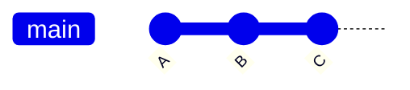
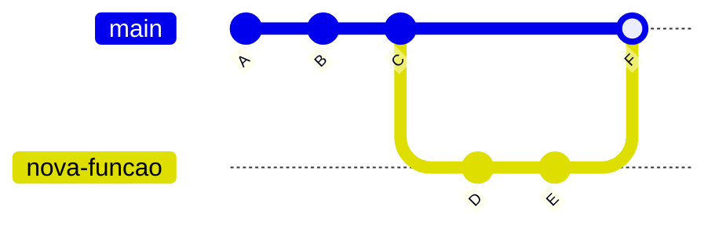

# Módulo 5 — Branches e Merge

> ⏱️ Duração estimada: 1 hora
> 📋 Pré-requisitos: [Módulo 4](../04-github/README.md)
> 🎬 Slides da aula: [apresentacao-05-branches.pdf](apresentacao/apresentacao-05-branches.pdf)

## 5.1 O que é um branch?

Até agora, seu histórico é uma linha reta de commits no branch **`main`**:



Um **branch** (ramo) é uma **linha de desenvolvimento paralela**. Ele permite experimentar, desenvolver uma funcionalidade ou corrigir um bug **sem mexer na versão que funciona**:



> 💡 **Analogia:** o `main` é o **caderno passado a limpo**; um branch é uma **folha de rascunho**. Você experimenta à vontade no rascunho e, quando o resultado fica bom, passa a limpo (faz o *merge*). Se ficar ruim, joga o rascunho fora — o caderno continua intacto.

Quando usar branches neste semestre:

- ✅ Testar uma solução alternativa de um exercício sem perder a atual;
- ✅ Desenvolver uma parte do trabalho em grupo sem atrapalhar os colegas;
- ✅ Contribuir com projetos de outras pessoas (Módulo 6);
- ℹ️ Para os exercícios individuais do dia a dia, commitar direto no `main` está OK.

## 5.2 Criando e trocando de branch

Continue no repositório `ola-git`. Veja os branches existentes:

```bash
git branch
```

```
* main
```

O `*` indica o branch atual. Crie um branch e mude para ele:

```bash
git switch -c despedida
```

```
Switched to a new branch 'despedida'
```

> 💡 `git switch -c nome` **c**ria e já troca para o branch. Para trocar entre branches existentes: `git switch nome`. (Em tutoriais antigos você verá `git checkout -b` — faz a mesma coisa; `switch` é o comando moderno e mais claro.)

```bash
git branch
```

```
* despedida
  main
```

## 5.3 Commitando no branch

Edite o `index.js` e adicione uma linha:

```javascript
console.log("Tchau, até a próxima!");
```

Commite normalmente:

```bash
git add index.js
git commit -m "Adiciona mensagem de despedida"
```

Agora, a mágica — volte para o `main` e abra o `index.js`:

```bash
git switch main
cat index.js
```

**A linha de despedida sumiu!** 😱 Calma: ela não sumiu — ela está no branch `despedida`. O `main` continua exatamente como estava. Cada branch guarda sua própria versão dos arquivos, e o Git troca os arquivos da pasta ao trocar de branch.

```bash
git log --oneline --all --graph
```

```
* 3c4d5e6 (despedida) Adiciona mensagem de despedida
* 9a8b7c6 (HEAD -> main, origin/main) Adiciona comentário via GitHub
* f4e5d6c Adiciona segunda mensagem no programa
* a1b2c3d Adiciona programa inicial que imprime saudação
```

## 5.4 `git merge` — trazendo as mudanças de volta

Gostou do resultado do rascunho? Hora de passar a limpo. O merge sempre é feito **a partir do branch que vai receber** as mudanças:

```bash
git switch main          # 1. vou para o branch que RECEBE
git merge despedida      # 2. trago as mudanças do outro branch
```

```
Updating 9a8b7c6..3c4d5e6
Fast-forward
 index.js | 1 +
 1 file changed, 1 insertion(+)
```

Pronto: o `main` agora contém a mensagem de despedida. O branch pode ser apagado:

```bash
git branch -d despedida
```

## 5.5 Conflitos: quando dois branches mexem na mesma linha

O Git mescla mudanças automaticamente **quando elas não se sobrepõem**. Mas se dois branches alterarem **a mesma linha do mesmo arquivo**, o Git não sabe qual versão escolher — e pede sua ajuda. Isso é um **conflito**.

### Provocando um conflito de propósito

```bash
# Branch 1: muda a primeira linha
git switch -c versao-a
# edite a 1ª linha do index.js para: console.log("Olá do branch A!");
git add . && git commit -m "Muda saudação para versão A"

# Volta ao main e muda A MESMA linha de forma diferente
git switch main
# edite a 1ª linha do index.js para: console.log("Olá do MAIN!");
git add . && git commit -m "Muda saudação no main"

# Tenta o merge...
git merge versao-a
```

```
Auto-merging index.js
CONFLICT (content): Merge conflict in index.js
Automatic merge failed; fix conflicts and then commit the result.
```

### Anatomia de um conflito

Abra o `index.js`. O Git marcou o trecho conflitante:

```
<<<<<<< HEAD
console.log("Olá do MAIN!");
=======
console.log("Olá do branch A!");
>>>>>>> versao-a
```

- Entre `<<<<<<< HEAD` e `=======`: a versão do branch atual (`main`);
- Entre `=======` e `>>>>>>> versao-a`: a versão do branch que está sendo mesclado.

### Resolvendo

1. **Edite o arquivo** deixando apenas o conteúdo final desejado (pode ser uma das versões, ou uma combinação). **Apague as linhas de marcação** (`<<<<<<<`, `=======`, `>>>>>>>`):

```javascript
console.log("Olá do MAIN e do branch A!");
```

2. Marque como resolvido e conclua o merge:

```bash
git add index.js
git commit -m "Resolve conflito unificando as saudações"
```

> 💡 O **VS Code** detecta conflitos e mostra botões como *Accept Current Change* / *Accept Incoming Change* / *Accept Both* — mais confortável que editar na mão. Mas entenda o formato bruto: você vai encontrá-lo pela vida toda.

> 😌 **Conflito não é erro nem catástrofe.** É o Git sendo honesto: "duas pessoas mudaram a mesma coisa, decida você". Resolver conflitos é habilidade do dia a dia de qualquer dev.

## 5.6 Branches e o GitHub

Para enviar um branch ao GitHub:

```bash
git push -u origin nome-do-branch
```

No GitHub, o seletor de branches (canto superior esquerdo da lista de arquivos) permite navegar entre eles. Branches remotos são a base dos **Pull Requests**, tema do próximo módulo.

## ✅ Checkpoint do módulo

1. O que acontece com os arquivos da pasta quando você troca de branch?
2. Em qual branch você deve estar para executar `git merge outro-branch`?
3. O que significam as marcações `<<<<<<<`, `=======` e `>>>>>>>`?
4. Quais os passos para resolver um conflito?

🏋️ **Agora faça o [Exercício 03](../exercicios/exercicio-03.md)!**

---

⬅️ [Módulo 4 — GitHub](../04-github/README.md) | ➡️ [Módulo 6 — Fluxo de Trabalho](../06-fluxo-de-trabalho/README.md)
