<!-- _class: capa -->

<div class="emoji">🌿</div>

# Branches e Merge

## Módulo 5 · Curso de Git e GitHub

<div class="meta">⏱️ 1 hora &nbsp;·&nbsp; 📋 Requer o Módulo 4</div>

---

## Roteiro

1. O que é um **branch** — e por que existe
2. Criar, trocar e commitar num branch
3. `git merge` — trazendo as mudanças de volta
4. **Conflitos** — provocar, entender e resolver
5. Branches no GitHub

---

## Até agora: uma linha reta



Cada commit em cima do anterior, todos no branch **`main`**.

---

<!-- _class: diagrama -->

## Um branch é uma linha paralela



---

<!-- _class: lead -->

## 💡 O caderno e o rascunho

O **`main`** é o caderno passado a limpo.
Um **branch** é uma folha de rascunho.

Você experimenta à vontade no rascunho e, quando fica bom, **passa a limpo** — isso é o *merge*.

Se ficar ruim, joga o rascunho fora. O caderno continua intacto.

---

<!-- _class: lista-limpa -->

## Quando usar um branch

- ✅ Testar uma solução alternativa **sem perder** a atual;
- ✅ Desenvolver a sua parte de um trabalho em grupo sem atrapalhar os colegas;
- ✅ Contribuir com projetos de outras pessoas — Módulo 6;
- ℹ️ Para exercícios individuais do dia a dia, commitar direto no `main` está **OK**.

---

## Vendo e criando branches

```bash
git branch            # lista; o * marca onde você está
git switch -c despedida
git branch
```

```
* despedida
  main
```

> 💡 `git switch -c nome` **c**ria e já troca. Para ir a um branch existente: `git switch nome`. Em tutoriais antigos aparece `git checkout -b` — faz o mesmo; `switch` é o comando moderno.

---

## Commitando no branch

Edite o `index.js`, acrescentando uma linha:

```javascript
console.log("Tchau, até a próxima!");
```

```bash
git add index.js
git commit -m "Adiciona mensagem de despedida"
```

Até aqui, nada de novo — o ciclo do Módulo 3, igualzinho.

---

## Agora a mágica: volte para o `main`

```bash
git switch main
cat index.js
```

**A linha de despedida sumiu!** 😱

Calma: ela não sumiu — está no branch `despedida`. O `main` continua exatamente como estava.

> 💡 Cada branch guarda a **sua própria versão** dos arquivos. Ao trocar de branch, o Git troca o conteúdo da pasta.

---

## Vendo os dois de uma vez

```bash
git log --oneline --all --graph
```

```
* 3c4d5e6 (despedida) Adiciona mensagem de despedida
* 9a8b7c6 (HEAD -> main, origin/main) Adiciona comentário
* f4e5d6c Adiciona segunda mensagem no programa
* a1b2c3d Adiciona programa inicial
```

`--all` mostra todos os branches; `--graph` desenha as linhas.

---

## `git merge` — passando a limpo

```bash
git switch main          # 1. vá para o branch que RECEBE
git merge despedida      # 2. traga as mudanças do outro
git branch -d despedida  # 3. rascunho cumprido, pode apagar
```

> ⚠️ O merge é sempre feito **a partir do branch que vai receber** as mudanças. Errar isso é o engano mais comum do módulo: você acaba levando o `main` para dentro do rascunho, em vez do contrário.

---

## Conflito: quando os dois mexem na mesma linha

O Git mescla sozinho **quando as mudanças não se sobrepõem**.

Mas se dois branches alterarem **a mesma linha do mesmo arquivo**, ele não tem como escolher — e pede a sua ajuda.

```
Auto-merging index.js
CONFLICT (content): Merge conflict in index.js
Automatic merge failed; fix conflicts and then commit the result.
```

---

## Provocando um de propósito

```bash
git switch -c versao-a
# 1ª linha → console.log("Olá do branch A!");
git add . && git commit -m "Muda saudação para versão A"

git switch main
# A MESMA 1ª linha → console.log("Olá do MAIN!");
git add . && git commit -m "Muda saudação no main"

git merge versao-a       # 💥
```

---

## Anatomia de um conflito

```
<<<<<<< HEAD
console.log("Olá do MAIN!");
=======
console.log("Olá do branch A!");
>>>>>>> versao-a
```

- Entre `<<<<<<< HEAD` e `=======` — a versão do branch **atual**;
- Entre `=======` e `>>>>>>>` — a versão do branch **que chega**.

---

## Resolvendo, em dois passos

**1.** Edite o arquivo deixando só o conteúdo final — e **apague as três marcações**:

```javascript
console.log("Olá do MAIN e do branch A!");
```

**2.** Marque como resolvido e conclua:

```bash
git add index.js
git commit -m "Resolve conflito unificando as saudações"
```

> 💡 O VS Code mostra botões *Accept Current* / *Incoming* / *Both*. Mais confortável — mas entenda o formato bruto, você vai reencontrá-lo a vida toda.

---

<!-- _class: lead -->

## 😌 Conflito não é erro nem catástrofe

É o Git sendo honesto:

*"duas pessoas mudaram a mesma coisa — decida você."*

Resolver conflito é habilidade de rotina de qualquer dev.

---

## Branches no GitHub

```bash
git push -u origin nome-do-branch
```

No GitHub, o **seletor de branches** fica no canto superior esquerdo da lista de arquivos.

> 💡 Branch remoto é a base do **Pull Request** — tema do próximo módulo.

---

<!-- _class: checkpoint -->

## ✅ Checkpoint do módulo

1. O que acontece com os arquivos da pasta ao trocar de branch?
2. Em qual branch você precisa estar para rodar `git merge outro`?
3. O que significam `<<<<<<<`, `=======` e `>>>>>>>`?
4. Quais são os passos para resolver um conflito?

---

<!-- _class: lead -->

## 🏋️ Agora é com você

**Exercício 03 — Branches e merge**

`exercicios/exercicio-03.md`

Depois vem o **Módulo 6**, onde branches viram
**Pull Requests** e o trabalho passa a ser em equipe.
